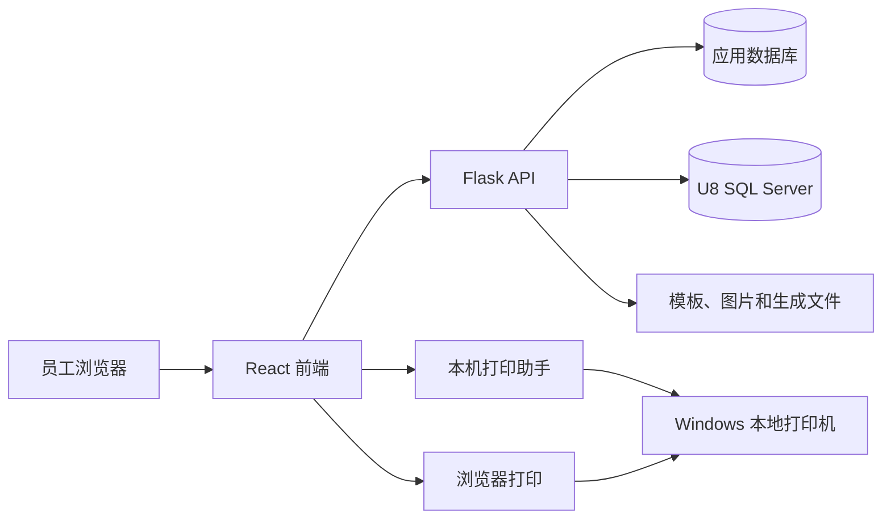

# 标签打印系统项目说明

> 文档基线：BarcodeLabelGen 0.23.2，按 2026-10-19 的当前代码核对。本文用于开发交接、部署、业务确认和问题排查。若本文与源码冲突，以当前源码、数据库迁移和实际配置为准，并同步修正文档。快速启动见 README，跨项目复用见 docs/项目复用指南.md。

## 1. 项目定位

本项目是在开源项目 **BarcodeLabelGen** 基础上扩展的网页标签打印系统，目标是逐步承接原 .NET/CODESOFT 标签打印流程。系统把标签设计、模板管理、U8 单据查询、库存标签打印、标签补打、打印记录、打印机管理和用户权限集中在浏览器中。

独立发布仓库为 [New_Label_Print_System](https://github.com/xinyuan445-commits/New_Label_Print_System)，仓库根目录即本项目。旧本机目录仍可能为 `labelPrint/BarcodeLabelGen`，换环境时应按实际路径配置。

系统的核心边界如下：

- **本系统负责**：模板设计与保存、变量替换、标签生成、打印任务准备、U8 单据和库存查询、追溯记录写入、用户和权限管理。
- **U8 负责**：单据、存货、仓库、货位、批号、数量等业务源数据。
- **浏览器或打印助手负责**：把生成的标签交给当前员工电脑上的打印机。
- **打印机驱动负责**：实际输出到 Zebra、TSC、普通热敏打印机或 Microsoft Print to PDF。

项目当前适合内网使用。上线前仍需用现场打印机、真实标签纸和业务流程完成验收。

## 2. 当前功能范围

| 模块 | 当前能力 |
| --- | --- |
| 首页 | 展示待打印 U8 单据、打印进度、模板和打印入口 |
| 单据打印 | 查询 U8 单据与明细；按明细生成标签；批量修改包装方式；空选择按全部明细处理 |
| 存货打印 | 按仓库、货位、料号/名称、批号筛选库存；必须明确勾选库存后才能打印 |
| 标签补打 | 输入流水号查询原标签数据并按原信息补打，不生成新流水号 |
| 模板管理 | 新建、重命名、导入、导出、共享、设置默认模板、查看和恢复版本 |
| 模板设计 | 文本、条码、二维码、线、方框、图片、表格；尺寸、方向、圆角、缩放和变量设置 |
| 模板库 | 保存和复用公共模板及文件夹 |
| 生成记录 | 查看历史生成结果，点击记录可预览或再次下载 |
| 打印机管理 | 读取当前客户端打印机；设置默认打印机和是否显示；管理高级连接设备 |
| 用户管理 | 创建用户、角色、启停账号、重置密码、按账号控制功能权限和菜单显示 |
| 主题和语言 | 浅色/深色主题；中文、英文、波兰文 |

主要网页路由：

| 地址 | 页面 |
| --- | --- |
| `/` | 首页 |
| `/bills` | 单据打印 |
| `/stock` | 存货打印 |
| `/reprint` | 标签补打 |
| `/templates` | 模板管理 |
| `/templates/:id/edit` | 模板设计 |
| `/library` | 模板库 |
| `/history` | 生成记录 |
| `/devices` | 本地打印机管理 |
| `/devices/advanced` | 高级打印设备管理 |
| `/admin/users` | 用户与权限管理 |
| `/help` | 帮助 |

## 3. 系统架构



### 3.1 数据分层

系统同时使用两类数据库，不能混为一谈：

1. **应用数据库**
   - 本机试运行：SQLite，默认文件为 `.local-data/pilot.db`。
   - 容器部署：PostgreSQL 16。
   - 保存用户、权限、模板、模板版本、常用单据、数据集、生成记录、设备等应用数据。

2. **U8 SQL Server**
   - 读取 U8 单据、明细、库存、仓库、货位和存货档案。
   - 测试账套允许在确认打印完成后写入三张追溯表。
   - 不保存网页登录用户或模板。

### 3.2 文件存储

本机模式默认使用 `.local-data`：

| 路径 | 内容 |
| --- | --- |
| `.local-data/pilot.db` | SQLite 应用数据库 |
| `.local-data/uploads` | 上传的数据文件 |
| `.local-data/assets` | 模板图片等资源 |
| `.local-data/pdfs` | 生成的 PDF 等文件 |
| `.local-data/secret.key` | 本机服务密钥 |

模板不会因正常重启丢失。若删除或替换 `.local-data/pilot.db`、切换到另一套数据库、从不同工作目录启动，看到的模板和用户数据会改变。部署迁移时应把应用数据库和相关文件目录作为一个整体备份。

## 4. 技术栈

### 4.1 前端

- React 18、TypeScript 5.7、Vite 6
- React Router 7
- TanStack Query 5：服务端数据请求和缓存
- Zustand 5：模板编辑器状态
- Konva / react-konva：标签画布和对象编辑
- Tailwind CSS 3：界面样式
- i18next：中文、英文、波兰文国际化
- Vitest、ESLint、Prettier：测试和代码质量

### 4.2 后端

- Python 3.12+
- Flask 3、Gunicorn
- SQLAlchemy 2、Alembic
- Flask-Login、Flask-Session
- Pydantic 2
- Argon2：密码哈希
- pyodbc：连接 U8 SQL Server
- psycopg、Redis：容器部署使用
- ReportLab、Pillow、python-barcode、qrcode：PDF、图片、条码和二维码生成
- pandas、openpyxl、pdfplumber：数据文件和 PDF 处理
- pytest、Ruff、MyPy：测试、格式和类型检查

### 4.3 打印助手

- Go 1.25
- Windows 打印队列接口：`github.com/alexbrainman/printer`
- 默认监听本机回环地址 `127.0.0.1:9110`
- 安装目录默认位于当前 Windows 用户的 `%LOCALAPPDATA%/LabelPrintingAssistant`
- 本地任务账本默认位于 `%LOCALAPPDATA%/blg-connector/label-jobs`

### 4.4 部署组件

- Docker Compose
- Nginx
- PostgreSQL 16
- Redis 7
- GitHub Actions CI

## 5. 目录结构

```text
BarcodeLabelGen/
├─ backend/                    Python/Flask 后端
│  ├─ app/routes/              HTTP API
│  ├─ app/services/            业务服务
│  ├─ app/services/u8_sql/     各类 U8 单据 SQL
│  ├─ app/models/              应用数据库模型
│  ├─ alembic/                 PostgreSQL 数据库迁移
│  ├─ tests/                   后端测试
│  └─ local_server.py          Windows 本机试运行入口
├─ frontend/                   React 前端
│  ├─ src/pages/               业务页面
│  ├─ src/editor/              标签设计器
│  ├─ src/components/          公共组件
│  ├─ src/i18n/locales/        语言文件
│  └─ dist/                    构建产物
├─ connector/                  本地打印助手
├─ docs/                       帮助、设计、SQL 和维护资料
├─ tools/                      项目工具
├─ compose.yml                 容器部署编排
├─ .env.example                配置示例
├─ AGENTS.md                   项目开发约束
└─ LICENSE                     GPL-3.0 许可证
```

## 6. U8 账套与安全边界

当前约定必须严格执行：

- `ufdata_008_2021` 是正式账套，**只允许查询**。
- `ufdata_998_2021` 是测试账套，允许测试打印和追溯写入。
- 后端不仅检查配置值，写入前还应校验 SQL Server 当前实际数据库为 998。
- 条码第一段的账套代码由 `U8_BARCODE_ACCOUNT_CODE` 单独配置，默认 `008`，它不等于当前连接的数据库名。
- 不把数据库账号、密码、生产数据或 `.env` 提交到 Git。
- 所有 SQL 参数应继续使用参数化查询，不拼接用户输入。

切换账套只能修改本机 `.env`，不要直接改源码默认值。正式环境切换到 008 时，打印、补打和追溯登记必须保持禁用；若未来确需开放，应另行评审并增加操作审计和备份方案。

## 7. U8 单据规则

当前支持 11 类单据：

| 代码 | 单据 |
| --- | --- |
| `CGDH` | 采购到货单 |
| `CGRK` | 采购入库单 |
| `XSCK` | 销售出库单 |
| `CCPRK` | 产成品入库单 |
| `OtherIN` | 其他入库单 |
| `OtherOUT` | 其他出库单 |
| `CLCK` | 材料出库单 |
| `DBD` | 调拨单 |
| `PDD` | 盘点单 |
| `XTZY` | 形态转换单 |
| `HWTZ` | 货位调整单 |

### 7.1 首页待打印

- 默认检查近 30 天单据。
- 待打印范围覆盖全部支持的单据类型，不受某个账号“常用单据”影响。
- 常用单据只用于个人快捷选择，每个账号最多 8 项。
- 入库类按正数明细判断。
- 销售出库、其他出库、材料出库的负数明细视为退回入库，也需要标签。
- 盘点单按实盘数量 `iCVCQuantity` 判断。
- 调拨单和货位调整单要结合已有 PDA 标签剩余数量判断：整托、整包且标签仍可继续使用时不重复打印；拆零时才需要新标签。
- 待打印进度按单据明细及应打数量核对三张追溯表。旧数据若缺少明细定位信息，会显示为“待核对”，避免误判为已完成。

### 7.2 单据打印

- 点击单据行直接加载明细。
- 明细未勾选时表示打印当前单据的全部可打印明细。
- 明细可批量修改包装方式。
- 标签数量由业务数量和包装方式计算，并受单次生成上限约束。
- 默认模板和打印机在页面底部的打印操作区选择。

### 7.3 存货打印

- 库存来源为 `CurrentStock` 和 `InvPositionSum`。
- 只查询有效仓库中数量大于 0 的库存。
- 支持仓库、货位、料号/名称、批号筛选。
- 必须明确勾选库存行；不选择时禁止打印。
- 打印确认弹窗展示已选库存，并允许在打印前修改打印数量和包装方式。
- 库存标签使用查询得到的批号；业务单号按打印时刻生成，格式为 `YYYYMMDDHH`。

库存查询 SQL 见 [backend/app/services/u8_sql/inventory_stock.sql](backend/app/services/u8_sql/inventory_stock.sql)。

## 8. 追溯表写入规则

新标签在确认打印完成后，每张标签以一个事务写入：

- `TraceBackOrder`
- `TraceBackGoods`
- `TraceBackOnlyCode`

主要约定：

- 每张标签在三张表各有一条相互关联的记录。
- `TraceBackOrder.orderType` 使用“打印平台”。
- 条码结构为 `账套代码|料号|批号|数量|SN`。
- SN 为 22 位流水号。
- 新记录会在追溯 JSON 中保存 `labelPrintSource`，包括单据类型、主表 ID、明细 ID 和行号，用于准确计算打印进度。
- 三张表完整重复时按幂等处理；仅写入一部分或关联冲突时拒绝继续，避免产生半套数据。
- 补打沿用原标签信息，不写三张表、不生成新 SN。

浏览器只能知道“任务已交给打印流程”，无法确认纸张是否真正打印成功。追溯登记的触发点和现场异常处理必须纳入员工培训。

待打印查询参考 SQL 见 [docs/sql/pending-labels.sql](docs/sql/pending-labels.sql)。该 SQL 主要用于核对逻辑；正式业务仍通过后端服务执行，不能把示例 SQL 直接当作生产写入脚本。

## 9. 模板系统

### 9.1 模板数据

- 开启 `SHARED_TEMPLATES=1` 后，有模板管理权限的用户共用模板。
- 常用单据仍按账号单独保存。
- 模板可导出为 `.blg-template.json`，建议重要模板定期导出作为独立备份。
- 手动保存会创建模板版本；自动保存只更新当前内容。
- 每个模板保留最近 30 个版本。
- 默认模板目前保存在浏览器本地设置中，换电脑或清理浏览器数据后需要重新选择。

### 9.2 设计能力

- 画布尺寸使用毫米。
- 支持横向、纵向和圆角标签纸。
- 画布缩放只改变编辑视图，不改变标签实际尺寸和组件坐标。
- 支持文本、条码、二维码、线、方框、图片和表格。
- 表格暂不支持合并单元格，可用方框和文本组合实现类似效果。
- 中文粗体由 PDF 字体处理提供兼容方案，但仍需以实际打印机和 PDF 查看器结果为准。
- 可生成 PDF，并支持 ZPL、TSPL 的导入或导出能力。
- ZPL/TSPL 对复杂字体、图片和部分画布效果的支持程度不同，导出前必须预览并实机试打。

### 9.3 数据变量

新单据标签当前提供：单据编码、行号、物料编码、物料名称、批号、数量、单位、sn、条码及固定账套名。库存另外提供仓库编码/名称、货位编码/名称、规格型号。查询字段不等于模板变量；单据模板不能直接假定有库存的扩展变量。补打字段还取决于历史数据和原快照。完整字段口径见 [项目复用指南](docs/项目复用指南.md)。

修改或新增变量时应同时检查：

1. U8 查询 SQL 是否返回该字段。
2. 后端是否把字段加入打印快照。
3. 前端变量选择器是否展示。
4. PDF、ZPL、TSPL 渲染是否都能替换。
5. 补打是否能从历史追溯信息恢复该字段。

## 10. 打印方式

### 10.1 浏览器打印

适合不安装打印助手的电脑：

1. 系统生成标签 PDF。
2. 浏览器打开打印预览。
3. 用户在系统打印对话框中选择本机打印机。
4. 用户确认已完成打印后，系统登记追溯数据。

限制：网页无法直接列出操作系统打印机，也无法知道纸张是否真正输出。使用 Microsoft Print to PDF 时，文件名仍可能由系统对话框决定。

### 10.2 本地打印助手

适合需要网页直接读取本机打印机列表、减少打印步骤或稳定输出文件名的电脑：

- 助手运行在员工电脑，而不是服务器。
- 网页通过 `127.0.0.1:9110` 与本机助手通信。
- 助手读取当前电脑的打印机，并通过 Windows 打印队列提交任务。
- 使用 Microsoft Print to PDF 时，可按 `单号_行号_SN.pdf` 保存到“下载/标签打印”；补打进入补打子目录。
- 助手本地任务账本用于阻止同一任务被重复提交。

“打印队列已接受”不等于“纸张已成功输出”。缺纸、卡纸、碳带、驱动、端口和打印机离线仍由现场处理。

详细说明见 [docs/client-printing.md](docs/client-printing.md) 和 [connector/README.md](connector/README.md)。

## 11. 用户、权限和本地设置

### 11.1 角色

当前角色：

- `admin`：管理员，可管理用户和全部业务功能。
- `editor`：编辑用户，按分配权限使用页面和功能。
- `viewer`：查看用户，按分配权限访问允许内容。

用户登录名当前使用 `email` 字段保存，但业务上不要求它必须是实际可收邮件的邮箱。密码没有复杂度要求，后端仍使用 Argon2 哈希保存，不能保存明文。

### 11.2 功能权限与菜单显示

两类控制必须区分：

- **功能权限**：决定用户能否调用单据、模板、打印机、模板库、生成记录等功能。
- **菜单显示**：管理员决定某个账号是否在侧栏看到首页、单据、模板、打印机、模板库、生成记录、帮助和用户管理入口。

隐藏菜单不应被当作安全权限。真正限制操作必须关闭相应功能权限，并由后端接口继续校验。

### 11.3 浏览器本地保存的设置

以下设置与浏览器和电脑有关，通常不会随账号在不同电脑间同步：

- 浅色/深色主题
- 默认模板
- 本地打印机的默认项和隐藏项
- 部分打印助手连接状态

因此“同一账号换电脑后设置不同”通常不是应用数据库丢失，应先检查浏览器本地存储和打印助手。

## 12. 配置说明

从 `.env.example` 复制为 `.env` 后填写。不要在文档、聊天记录、提交或截图中公开真实密码。

| 变量 | 作用 | 当前约定 |
| --- | --- | --- |
| `POSTGRES_PASSWORD` | PostgreSQL 密码 | 容器部署必填 |
| `SECRET_KEY` | Flask 会话和 CSRF 密钥 | 必须使用随机值 |
| `SHARED_TEMPLATES` | 是否共用模板 | 当前使用 `1` |
| `LABEL_HOSTS` | 本机服务监听地址 | 多地址用逗号分隔 |
| `LABEL_PORT` | Web 服务端口 | 默认 `18003` |
| `U8_DATABASE` | 当前 U8 数据库 | 测试使用 `ufdata_998_2021` |
| `U8_BARCODE_ACCOUNT_CODE` | 条码第一段账套代码 | 默认 `008` |
| `U8_SERVER` | SQL Server 地址 | 不提交真实值 |
| `U8_USER` | SQL Server 用户 | 不提交真实值 |
| `U8_PASSWORD` | SQL Server 密码 | 不提交真实值 |

`LABEL_HOSTS=127.0.0.1` 时只能本机访问。需要内网其他电脑访问时，把服务器实际内网 IPv4 加入列表，并检查 Windows 防火墙的 18003 入站规则。不要只修改浏览器地址而不修改监听地址。

## 13. 本机启动

前置条件：

- Node.js 22
- Python 3.12
- `uv`
- Microsoft ODBC Driver 17 for SQL Server
- 可连接 U8 SQL Server 的网络和账号

首次或前端变更后构建：

```powershell
cd frontend
npm ci
npm run build
```

安装后端依赖并启动：

```powershell
cd backend
uv sync --frozen
uv run python local_server.py
```

默认访问：`http://127.0.0.1:18003/`。

本机入口会读取项目根目录 `.env`，使用 SQLite，并从 `frontend/dist` 提供网页。如果前端未构建，服务会提示先执行 `npm run build`。

管理员账号由 `LABEL_ADMIN_EMAIL` 和 `LABEL_ADMIN_PASSWORD` 初始化。若未提供初始密码，本机服务会生成随机密码并输出到启动日志。任何环境都不应把真实默认密码写入本文或源码。

也可从本目录执行 `start.ps1`；前端改动后执行 `start.ps1 -BuildFrontend`。启动脚本以自身目录定位项目，不清空应用库。详细步骤见 [部署与维护](docs/部署与维护.md)。本机使用 `.local-data/secret.key`，与 Docker 的 SECRET_KEY 分开；通用数据集异步批量生成仍依赖 Redis。

## 14. Docker 部署

```bash
docker compose up -d --build
docker compose exec web flask seed-admin
```

容器方案包含 Nginx、Flask、PostgreSQL 和 Redis。入口自动执行 Alembic 迁移，当前 head 为 0015_user_hidden_pages；管理员使用 ADMIN_EMAIL / ADMIN_PASSWORD 初始化，与本机入口不同。当前 `compose.yml` 默认只把 Web 服务绑定到宿主机 `127.0.0.1:18003`。要供内网访问，需要由反向代理、Tailscale 或网络配置对外提供服务。SQLite 不能直接复制为 PostgreSQL 数据卷。

部署时必须额外确认：

- Compose 是否把本环境所需的全部 U8 配置传入 Web 容器。
- 容器能否解析并访问 SQL Server。
- ODBC Driver 18 和证书选项是否与 SQL Server 匹配。
- PostgreSQL、上传文件、资源文件和生成文件是否有持久卷与备份。
- 反向代理是否启用 HTTPS、正确转发会话 Cookie，并限制访问来源。

## 15. 开发与质量检查

后端：

```powershell
cd backend
uv run ruff check .
uv run ruff format --check .
uv run mypy app
uv run pytest
```

前端：

```powershell
cd frontend
npm run format:check
npm run lint
npm run typecheck
npm test
npm run build
```

打印助手：

```powershell
cd connector
go test ./...
.\build-windows.ps1
```

仓库包含后端检查和测试，以及前端格式、Lint、类型检查、测试和构建的 GitHub Actions 定义。独立仓库的工作流位于根目录，可由 GitHub 识别；旧嵌套工作区的子目录工作流不会自动执行。线上 CI 状态以 Actions 实际结果为准。硬件打印、U8 真实连接、标签位置和条码扫描仍要执行现场 UAT。

## 16. 数据备份与恢复

### 16.1 本机模式

停止服务后备份：

- `.env`：单独加密保管，不进入代码仓库。
- `.local-data/pilot.db`
- `.local-data/assets`
- `.local-data/uploads`
- `.local-data/pdfs`（需要保留历史生成文件时）

恢复时保持目录结构一致，并使用相同或兼容版本启动。仅恢复数据库而遗漏资源目录，可能导致模板存在但图片或历史 PDF 无法打开。

### 16.2 容器模式

- 定期做 PostgreSQL 逻辑备份并验证恢复。
- 同步备份上传、资源和生成文件卷。
- 记录当前镜像版本、`.env` 配置和迁移版本。
- 恢复演练应验证登录、模板、U8 查询、PDF 生成和测试账套追溯写入。

项目目前没有完整的自动备份与一键恢复流程，正式上线前应补齐。

## 17. 已知限制和风险

### 17.1 业务与数据

- 008 正式账套保持只读，当前不能在该账套完成真实追溯登记。
- 待打印只检查近 30 天，并有候选数量和返回数量上限；大数据量下仍需评估 SQL 性能。
- 老追溯数据缺少明细定位字段时只能标记“待核对”。
- 当前没有跨用户打印占用锁，两名用户可能同时准备同一单据，应通过现场流程避免重复打印。
- 补打次数尚未实现，待供应商确认可依赖的数据字段或规则。
- 调拨、货位调整的整托/拆零判断依赖三张追溯表历史数据质量。

### 17.2 打印

- 浏览器不能直接读取远程员工电脑的打印机列表；需要本机打印助手。
- 打印助手提交成功不代表实际出纸成功。
- 浏览器打印无法稳定控制 Microsoft Print to PDF 的默认文件名。
- 不同打印机 DPI、驱动缩放、纸张间隙、黑标和方向会影响位置，必须按型号校准。
- ZPL、TSPL 和 PDF 的渲染能力不同，复杂模板不能假设三种输出完全一致。
- 单个客户端打印包限制为压缩 64 MiB、解压 128 MiB。

### 17.3 模板和文件

- 表格不支持合并单元格。
- 两人同时编辑同一共享模板时缺少完整的乐观锁保护，后保存可能覆盖先保存。
- CSV、XLS、XLSX 单文件上限 10 MB、最多 1000 行。
- SQLite 数据源文件上限 50 MB，单次查询最多 1000 行，只允许单条只读 `SELECT`。
- 模板图片单文件上限 5 MB。
- 单次批量生成最多 1000 张标签。
- 生成记录在新增记录时惰性清理超过 30 天的记录和相应文件，不是定时清理保证；批次清单及其他文件需单独考虑归档。
- 每台捕获设备最多保留最近 200 条捕获记录。

### 17.4 运维与安全

- 本机 SQLite 适合试运行，不适合多实例并发部署。
- 内网 HTTP 可被同网段监听；正式使用建议通过 HTTPS 入口访问。
- 日志、生成文件和追溯表可能包含料号、批号、数量等业务信息，应限制访问和备份权限。
- 不应把“隐藏菜单”当作权限控制。
- 项目尚未形成自动化监控、告警、备份和灾难恢复闭环。

## 18. 建议的上线顺序

1. 固定测试账套 998，确认所有 11 类单据查询字段和数量口径。
2. 选 2～3 个常用模板，完成 PDF、ZPL、TSPL 的对照打印。
3. 用 Zebra、TSC 和至少一台普通热敏打印机做尺寸、方向、中文、粗体和条码扫描测试。
4. 核对每张标签在三张追溯表中的记录，以及首页待打印进度是否随打印减少。
5. 测试打印失败、取消打印、重复提交、网络中断和补打流程。
6. 确认用户权限、菜单显示和不同电脑的本地打印机设置。
7. 完成应用数据库和文件目录的备份恢复演练。
8. 培训员工后小范围试运行，再决定 008 的后续接入方案。

## 19. 维护规则

开发时遵守以下原则：

- 只在本项目目录内修改 BarcodeLabelGen，不连带修改上层其他项目。
- 先读 [AGENTS.md](AGENTS.md) 和 `docs/aoci` 下的业务约束。
- 新功能需要同时考虑中文界面、权限、测试、数据迁移和补打兼容。
- 页面文案保持简短，不在业务界面暴露表名、SQL 和实现细节。
- 数据库变更通过 Alembic；不要依赖 `create_all` 替代正式迁移。
- 新增 U8 写入必须默认拒绝 008，并提供事务、幂等和失败恢复设计。
- 修改打印快照字段时，必须核对新打印、浏览器打印、助手打印、生成记录和补打。
- 修改模板格式时，必须考虑旧模板的向后兼容和导入导出。
- 不提交 `.env`、`.local-data`、生成文件、真实业务数据或数据库凭据。

## 20. 资料索引

| 文档 | 用途 |
| --- | --- |
| [README.md](README.md) | 当前项目入口和快速启动 |
| [docs/README.md](docs/README.md) | 当前文档目录与历史资料边界 |
| [docs/项目复用指南.md](docs/项目复用指南.md) | 无 AOCI 接手、模块依赖、接口及迁移 |
| [docs/部署与维护.md](docs/部署与维护.md) | 初始化、配置、启动、备份和排错 |
| [AGENTS.md](AGENTS.md) | 当前项目开发约束 |
| [docs/aoci/architecture.md](docs/aoci/architecture.md) | 当前架构和模块关系 |
| [docs/aoci/business-rules.md](docs/aoci/business-rules.md) | U8 与打印业务规则 |
| [docs/aoci/database-schema.md](docs/aoci/database-schema.md) | 应用数据库模型和追溯表说明 |
| [docs/aoci/known-issues.md](docs/aoci/known-issues.md) | 已知问题 |
| [docs/client-printing.md](docs/client-printing.md) | 浏览器与客户端打印流程 |
| [docs/u8-pdf-printing.md](docs/u8-pdf-printing.md) | U8 PDF 打印说明 |
| [docs/HELP.zh.md](docs/HELP.zh.md) | 中文操作帮助 |
| [docs/FAQ.zh.md](docs/FAQ.zh.md) | 中文常见问题 |
| [connector/README.md](connector/README.md) | 打印助手安装和配置 |
| [docs/UAT.md](docs/UAT.md) | 上线验收清单 |
| [docs/sql/pending-labels.sql](docs/sql/pending-labels.sql) | 待打印查询参考 SQL |
| [LICENSE](LICENSE) | GPL-3.0 许可证全文 |

## 21. 开源许可证

本项目继承 BarcodeLabelGen 的 **GNU GPL v3.0** 许可证。修改和分发时应保留版权及许可证信息，并按 GPL-3.0 履行对应的源代码提供义务。仅公司内部部署与向外部分发的义务可能不同；涉及商业交付、封闭分发或与其他专有组件组合时，应由有资质人员结合实际发布方式确认合规要求。

上游项目：<https://github.com/AmigoUK/BarcodeLabelGen>
